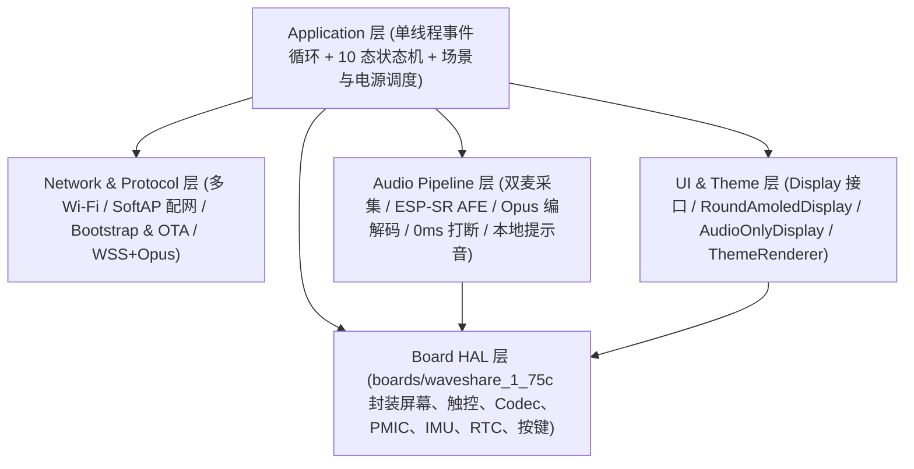

# AgentSphere ESP32 固件技术架构与模块规划

更新于 2026-11-19。本文基于 [产品功能需求](requirements.md) 与 [端云通信协议（v1 草案）](protocol.md)，定义 **ESP32 固件端** 的软件分层、16MB Flash 分区、双核任务调度、内存边界与真机落地路径。

首台验证板为微雪 `ESP32-S3-Touch-AMOLED-1.75C`（ESP32-S3R8，16MB Flash + 8MB Octal PSRAM），架构同时保持板级解耦以兼容后续不同屏幕或无屏 ESP32 设备。

---

## 1. 技术栈与核心组件

- **开发框架**：ESP-IDF `v6.1`（如遇到特定 BSP 依赖限制再按实测调整），Mac 本机命令行 / VS Code ESP-IDF 插件编译烧录。
- **开发语言**：现代 C++（C++17/20，关闭异常 `-fno-exceptions` 与 RTTI `-fno-rtti` 以节省 Flash/RAM）配合 ESP-IDF C 组件。
- **核心依赖（通过 `main/idf_component.yml` 锁定版本）**：

| 类别 | 组件 | 用途 |
| --- | --- | --- |
| 板级支持 | `waveshare/esp32_s3_touch_amoled_1_75c` | CO5300 AMOLED 屏、CST9217 触控、I2C/I2S/SPI 初始化基线 |
| 音频编解码硬件 | `espressif/esp_codec_dev` | 驱动 ES7210（双麦 + AEC 参考路）与 ES8311（功放/扬声器） |
| 端侧语音算法 | `espressif/esp-sr`（`>=2.6`） | AFE 音频前端（硬件参考路 AEC + NS 降噪 + VAD + WakeNet 唤醒） |
| Opus 编解码 | `espressif/esp_audio_codec`（或标准 `opus` 组件） | 16kHz 单声道 60ms 帧长 Opus 实时编码与解码 |
| 图形引擎 | `lvgl/lvgl`（v9）+ 对应 LVGL 适配层 | 466×466 圆屏主界面、快捷控制中心、场景菜单与表情动画 |
| 网络与配网 | `esp_http_client`、`espressif/esp_websocket_client`、`esp_http_server`、`cJSON` | HTTPS 控制面、WSS 语音面、SoftAP 配网页与轻量 DNS 劫持 |
| 外设驱动 | AXP2101 / QMI8658 / PCF85063 驱动 | 电源充放电遥测与开关机、6 轴 IMU 体感、RTC 走时 |

---

## 2. 16MB Flash 分区表规划

独立划分双 OTA 槽位、语音模型区与静态资源区，避免固件升级重复拉取大模型，并为二期玩偶皮肤包预留独立空间：

```csv
# Name,   Type, SubType,  Offset,   Size,     Flags
nvs,      data, nvs,      0x9000,   0x8000,
otadata,  data, ota,      0x11000,  0x2000,
phy_init, data, phy,      0x13000,  0x1000,
coredump, data, coredump, 0x20000,  0x10000,
ota_0,    app,  ota_0,    0x30000,  0x400000,
ota_1,    app,  ota_1,    0x430000, 0x400000,
model,    data, spiffs,   0x830000, 0x380000,
assets,   data, littlefs, 0xBB0000, 0x400000,
```

| 分区 | 大小 | 职责说明 |
| --- | --- | --- |
| `nvs` | 32 KB | 保存 3~5 个常用 Wi-Fi、`device_uid`、`device_token`、音量/亮度/休眠等用户偏好 |
| `otadata` | 8 KB | ESP-IDF 双分区启动与自动回滚状态 |
| `coredump` | 64 KB | 异常崩溃现场转储，供内测期定位问题 |
| `ota_0` / `ota_1` | 各 4.0 MB | 双槽位应用固件；新固件首次启动通过硬件与基础服务自检后才调用 `esp_ota_mark_app_valid_cancel_rollback()`，否则自动回滚旧版本 |
| `model` | 3.5 MB | `esp-sr` 语音模型（WakeNet / VAD / NS），独立于主程序槽位 |
| `assets` | 4.0 MB | 本地提示音（唤醒/思考/异常）、字体子集、一期表情素材与二期玩偶皮肤资源包（后续也可扩展挂载 TF 卡） |

> 合计占用约 15.69 MB，完整落入 16MB Flash 并保留余量。

---

## 3. 四层单向解耦架构与目录规划

### 3.1 分层架构图



### 3.2 源码目录规划

```text
AgentSphere-esp32/
├── CMakeLists.txt
├── partitions.csv
├── sdkconfig.defaults
├── docs/
│   ├── requirements.md
│   ├── protocol.md
│   └── architecture.md
└── main/
    ├── CMakeLists.txt
    ├── idf_component.yml
    ├── main.cc                      # app_main 入口，装配 Board 与 Application
    ├── app/
    │   ├── application.h/.cc        # 单线程主事件循环与调度中枢
    │   ├── state_machine.h/.cc      # 10 态运行状态机与合法迁移守卫
    │   └── events.h                 # 统一事件定义（按键/触摸/IMU/网络/语音/电源）
    ├── boards/
    │   ├── board.h                  # 跨板型抽象接口（Board / AudioCodec / Power / Imu / Rtc）
    │   └── waveshare_1_75c/         # 微雪 1.75C 板级实现（引脚、BSP、驱动胶水）
    ├── net/
    │   ├── wifi_manager.h/.cc       # 多 Wi-Fi 记忆（3~5 个）、扫描与优先级自动重连
    │   └── provisioning.h/.cc       # SoftAP + DNS Captive Portal + 192.168.4.1 内置配网页
    ├── protocol/
    │   ├── bootstrap_client.h/.cc   # HTTPS bootstrap / pairing-status / OTA 检查与下载校验
    │   └── ws_client.h/.cc          # WSS /device/v1/connect、hello 协商、Opus 收发与 turn_id 门禁
    ├── audio/
    │   ├── audio_service.h/.cc      # 采集/AFE/编码/解码/播报线程与 RingBuffer 管理
    │   ├── opus_codec.h/.cc         # 16kHz 单声道 60ms Opus 编解码封装
    │   └── tone_player.h/.cc        # 本地短提示音（唤醒/思考/异常/倒扣静音）
    ├── ui/
    │   ├── display.h                # 抽象 Display 接口（屏蔽有屏/无屏差异）
    │   ├── audio_only_display.h/.cc # 无屏设备实现（纯语音播报配对码与提示音）
    │   ├── round_amoled/            # 1.75C LVGL 界面实现
    │   │   ├── round_display.h/.cc  # 1 主屏 + 下滑控制中心 + 左滑场景菜单 + 配网/认领视图
    │   │   └── theme_renderer.h/.cc # 独立角色渲染接口（小安角色与状态指示，后续支持皮肤包）
    ├── power/
    │   └── power_policy.h/.cc       # 插电桌面态 vs 电池随身态、防烧屏息屏、自动关机与低电保护
    └── storage/
        └── settings_store.h/.cc     # NVS 持久化封装（Wi-Fi 列表、device_token、用户设置）
```

**跨设备复用保证**：
- 未来接入无屏 ESP32 或其他屏幕板型时，仅需在 `main/boards/` 增加对应板级目录并选择 `AudioOnlyDisplay`（或对应屏实现），`app/`、`net/`、`protocol/`、`audio/`、`power/`、`storage/` 零改动直接复用。
- 编译选项支持通过 Kconfig 开关（如 `CONFIG_AS_BOARD_WAVESHARE_1_75C`、`CONFIG_AS_ENABLE_LVGL`）在构建期裁掉无屏设备不需要的图形代码。

---

## 4. 核心子系统关键设计

### 4.1 单线程事件循环 + 状态机守卫
- Wi-Fi 回调、WSS 消息、按键中断、IMU 姿态变化、PMIC 电量变化、VAD 判停、定时器等外部信号，**一律封装为轻量 `AppEvent` 投递到主事件队列**。
- `Application` 单线程顺序消费事件并驱动 `StateMachine` 迁移，彻底消除多任务共享状态时的竞态和死锁。

### 4.2 音频管线与 0ms 打断机制
- **上行链路**：`ES7210 双麦 + 功放回采参考路` → `ESP-SR AFE（AEC + NS + VAD + WakeNet）` → 仅在 `Listening` 状态送入 `OpusEncoder（16kHz / Mono / 60ms）` → 上行队列 → WSS Binary 帧发送。
- **下行链路**：WSS 收到 `tts.start` 校验 `turn_id == active_turn_id` 且 `scene_id == active_scene_id` → 后续 Binary Opus 帧送入下行环形缓冲 → `OpusDecoder` → `ES8311` I2S 播放 → 播完触发 `delivery.ack` 并切入 8~10 秒追问窗口。
- **0ms 打断**：在 `Listening`/`Thinking`/`Speaking` 收到 `BOOT` 短按、触屏打断或 IMU 倒扣事件时：
  1. 立即失效/清空 `active_turn_id`；
  2. 立即清空下行 Opus 缓冲并静音/停止 I2S 播报；
  3. 异步发出 `abort(turn_id)`，此后网络管道中任何旧 `turn_id` 帧直接丢弃。
- **单轮录音保护**：设置上行录音硬上限（默认 30 秒），防止环境噪声导致 VAD 无法判停。

### 4.3 SoftAP 本地配网生命周期（零常驻开销）
- 仅在 `WifiConfiguring` 状态动态启动 `SoftAP`、`esp_http_server`（`192.168.4.1`）与轻量 UDP:53 DNS Captive Portal 劫持服务。
- 离开 `WifiConfiguring`（配网成功或用户选择离线跳过）后，**立即停止并彻底释放 HTTP/DNS 服务与 AP 缓冲**，平时待机零 RAM 占用、零多余射频功耗。

### 4.4 电源管理与防烧屏策略
- 通过 `AXP2101` 实时获取 `is_usb_plugged`、`is_charging`、`battery_percent`、`battery_voltage`：
  - **USB 插电态**：展示充电/满电动画，保持 Wi-Fi 与端侧唤醒常开；空闲超时仅降低 AMOLED 亮度或切换低功耗息屏/像素微移防烧屏，**永不自动关机**。
  - **电池随身态**：空闲超时（默认 30~60s，实测可调）→ 息屏并暂停持续麦克风监听进入 `Sleeping`；`Sleeping` 态下支持 IMU 拿起亮屏、`PWR` 亮屏、`BOOT` 一键亮屏直达对话；持续无操作超时（默认 10~15min）或电量低于保护阈值 → 安全保存状态并调用 `AXP2101` 断电关机。

### 4.5 1.75C 圆屏 UI 与皮肤解耦
- **视图层**：主屏（陪伴表情 + 边缘隐私状态环）、下滑快捷控制中心（音量/亮度/一键闭麦/电量/Wi-Fi/设置与二次确认重置）、左滑场景菜单（日常对话 / 英语口语练习），以及独立的全屏状态覆盖层（配网引导、6 位配对码、OTA 进度条）。
- **皮肤引擎**：`ThemeRenderer` 将 `DeviceState` 和 `Emotion` 交给小安角色渲染器，并独立绘制状态指示。全身招手和半身表情使用六张 224 × 188 的 RGB565 位图（约 494 KiB），随圆屏固件内嵌到应用 Flash，LVGL 使用单个图像对象绘制并按需要调度帧切换。终止当前对话、切换状态或息屏会立即更新姿态和动画调度。无屏构建不链接角色素材。后续皮肤包可从 `assets` 分区或 TF 卡加载。 [素材格式与打包](../main/ui/round_amoled/assets/README.md)

---

## 5. ESP32-S3 双核任务与内存边界

466×466 圆形 AMOLED（16-bit RGB565 单帧约 434 KB）与双麦 AFE + Opus + TLS/WSS 并行运行，必须严格划分双核优先级与 SRAM / PSRAM 归属：

### 5.1 双核任务绑定规划

| CPU 核 | 任务 | 优先级（相对） | 职责与约束 |
| --- | --- | --- | --- |
| **Core 0**（网络与系统控制） | Wi-Fi / LwIP / TLS | ESP-IDF 默认高 | 无线收发与加密通道 |
| **Core 0** | `ws_client` / `http` | 中高 | WSS 收发、心跳重连、HTTPS 引导与 OTA 下载 |
| **Core 0** | `app_main_loop` | 中 | 单线程消费 `AppEventQueue`、驱动状态机与电源策略 |
| **Core 0** | `input_sensor` | 中低 | `PWR`/`BOOT` 按键消抖、IMU 姿态判定（拿起/摇晃/倒扣）、AXP2101 电量采样 |
| **Core 1**（音频与图形渲染） | `audio_capture_afe` | **最高** | I2S 双麦+参考路采集与 ESP-SR AFE 处理，严禁被 UI 抢占 |
| **Core 1** | `audio_codec_play` | 高 | Opus 编解码、下行音频流解码与 I2S 播放、0ms 打断清队列 |
| **Core 1** | `lvgl_task` | 中 | 466×466 AMOLED 渲染与触控事件读取，优先级低于音频保障零爆音 |

### 5.2 内存与稳定性护栏
- **片内 SRAM（~512 KB）**：优先保障 Wi-Fi/TLS DMA 缓冲、I2S DMA 缓冲、关键实时任务栈，以及 LVGL QSPI DMA 双局部行缓冲（如 `466 × 40 × 2B ≈ 37 KB × 2`）。
- **8MB Octal PSRAM**：承载 ESP-SR AFE 运行内存、Opus 收发环形缓冲队列、LVGL 字体/表情/图层缓存、JSON 解析与 OTA 下载缓冲。
- **稳定性兜底**：启用 Task Watchdog（TWDT）防任务假死；关键节点打印剩余内部 SRAM / PSRAM 水位与最小历史水位，方便真机压测阶段提前发现内存泄漏。

---

## 6. 工程落地顺序（面向真机迭代）

1. **Step 0 · 开发环境与真机验板（Hardware Bring-up）**
   - 使用本机已安装的 ESP-IDF v6.1 工具链，搭建最小项目骨架与 `partitions.csv` 并核对 1.75C BSP 组件依赖兼容性；
   - 烧录微雪 1.75C 验板固件，逐项确认：AMOLED 点亮与刷新、CST9217 触摸、ES7210/ES8311 录音回放、AXP2101 电压/充放电/软关机、QMI8658 IMU 读数、PCF85063 RTC、`PWR`/`BOOT` 按键。
2. **Step 1 · 阶段 A（端云联调闭环）**
   - 实现 `wifi_manager` + SoftAP `192.168.4.1` 配网、`bootstrap`/`pairing-status` 6 位配对码认领、`WSS /device/v1/connect` + Opus 收发与 `delivery.ack`，与 AgentSphere 服务端跑通首次完整语音对话。
3. **Step 2 · 阶段 B（V1.0 C 端日常可用）**
   - 接入 `esp-sr`（AEC/VAD/WakeNet）、完整 10 态状态机、小安角色表情 + 下滑控制中心 + 触摸/IMU 互动、插电/电池功耗策略与自动关机、OTA 双分区升级回滚。
4. **Step 3 · 阶段 C（极简英语场景）**
   - 实现左滑场景菜单、`scene.enter`/`scene.exit` 上下文隔离与退出防串台丢包验证。
