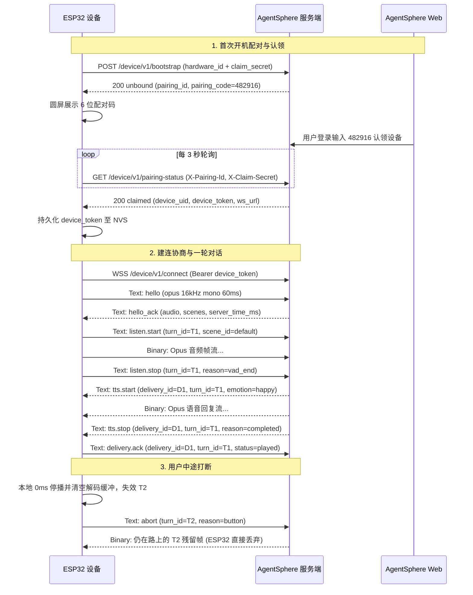

# AgentSphere ESP32 端云通信协议规范（v1 草案）

更新于 2026-11-19。本文定义 **ESP32 设备端** 与 **AgentSphere 服务端** 之间的通信契约，用于指导 ESP32 固件实现以及与服务端通道接入对齐。

## 1. 设计原则与边界

- **控制面与语音面分离**：
  - **控制面（HTTPS）**：负责开机引导、配对认领、长期凭据换取与 OTA 版本检查。
  - **语音面（WSS）**：负责已绑定设备的全双工语音流、状态信令、打断与场景切换。
  - 生产环境强制使用 `HTTPS` / `WSS`；本地局域网开发调试可通过编译/配置开关允许 `HTTP` / `WS`。
- **设备安全认证**：不信任设备单方面自报的 MAC 地址作为长期身份。未绑定设备通过临时 `claim_secret` 配合短期 6 位配对码换取长期可轮换的 `device_token`；未绑定设备无法连接语音网关或占用付费模型/语音资源。
- **直接采用 Opus 音频**：主音频编码固定优先采用 **Opus**（16kHz、单声道），并通过 `hello` 帧协商帧长与采样率细节，兼顾随身热点/弱网带宽与低延迟。
- **对齐平台核心契约**：
  - 每轮对话由设备端生成稳定 UUID `turn_id`（对应平台入站去重 `external_message_id`），防止弱网重传导致重复扣费。
  - 打断映射平台取消事件（`cancel`），重置会话映射 `new_conversation`，下行播报携带 `delivery_id` 并在端侧回传 `delivery.ack` 闭环投递状态。
- **跨板型通用**：协议不绑定屏幕尺寸或交互形态，有屏/无屏 ESP32 共用同一套报文。

---

## 2. 控制面接口（HTTPS）

### 2.1 开机引导与状态检查：`POST /device/v1/bootstrap`

设备联网后首先调用此接口，完成「绑定状态检查 / 配对码申请 / 网关地址获取 / OTA 检查」。

#### 请求头
- 已绑定设备携带：`Authorization: Bearer <device_token>`
- 未绑定设备不携带 `Authorization`

#### 请求体（JSON）

```json
{
  "hardware_id": "a4:cf:12:34:56:78",
  "board": "waveshare-1.75c",
  "fw_version": "0.1.0",
  "protocol_version": 1,
  "claim_secret": "仅未绑定或重新认领时提交的32字节随机十六进制串",
  "capabilities": {
    "has_screen": true,
    "screen": "466x466-round-amoled",
    "audio_formats": ["opus"],
    "aec": true
  }
}
```

> 说明：`hardware_id` 取自 ESP32 Efuse MAC，仅作硬件指纹与防抢占校验，不作为免密认证凭据。`claim_secret` 由未绑定设备在本地随机生成并暂存，服务端仅保存其单向摘要用于后续轮询验真。

#### 响应 A：已绑定（HTTP 200）

```json
{
  "status": "bound",
  "device_uid": "dev_01j...",
  "ws_url": "wss://api.agentsphere.example/device/v1/connect",
  "server_time_ms": 1795060000000,
  "rotated_device_token": null,
  "ota": {
    "latest_version": "0.2.0",
    "mandatory": false,
    "url": "https://api.agentsphere.example/firmware/waveshare-1.75c/0.2.0.bin",
    "sha256": "e3b0c44298fc1c149afbf4c8996fb924..."
  }
}
```

- `rotated_device_token`：非空时表示服务端触发凭据轮换，ESP32 必须将其原子持久化到 NVS，后续连接立即使用新 token。
- `ota`：无新版本时可为 `null`；存在新版本时由设备按电量条件决定立即或空闲执行双分区 OTA 升级。

#### 响应 B：未绑定，下发短期配对码（HTTP 200）

```json
{
  "status": "unbound",
  "pairing_id": "pair_01j...",
  "pairing_code": "482916",
  "expires_in": 300,
  "poll_interval_sec": 3,
  "server_time_ms": 1795060000000
}
```

- 设备进入 `Activating` 状态，屏幕展示 6 位 `pairing_code`（无屏设备语音播报），按 `poll_interval_sec` 轮询 `pairing-status`。

#### 常见异常响应
- `401` + `REAUTH_REQUIRED`：旧 `device_token` 已因 Web 端解绑或吊销而失效；ESP32 立即清除本地 token，生成新 `claim_secret` 重新调用 `bootstrap` 申请配对码。
- `409` + `DEVICE_ALREADY_BOUND`：该 `hardware_id` 仍归属其他账号且未解绑（例如未经解绑直接恢复出厂）；屏幕提示用户先由原账号在 AgentSphere Web 解绑后再认领，防止设备被抢占。

---

### 2.2 轮询认领状态：`GET /device/v1/pairing-status`

设备在 `Activating` 状态下按服务端给定的 `poll_interval_sec`（默认 3 秒）轮询，直至认领完成或配对码过期。

#### 请求头（避免敏感信息出现在 URL 日志中）
- `X-Pairing-Id: <pairing_id>`
- `X-Claim-Secret: <claim_secret>`

#### 响应 A：等待认领（HTTP 200）

```json
{
  "status": "pending",
  "expires_in": 240,
  "poll_interval_sec": 3
}
```

#### 响应 B：认领成功，一次性下发凭据（HTTP 200）

```json
{
  "status": "claimed",
  "device_uid": "dev_01j...",
  "device_token": "ast_dev_...",
  "ws_url": "wss://api.agentsphere.example/device/v1/connect"
}
```

- ESP32 收到后立即将 `device_uid` 与 `device_token` 持久化至 NVS，销毁临时 `claim_secret`，随后进入 `Idle` 并建立 WSS 连接。

#### 响应 C：配对码已过期（HTTP 200 或 410）

```json
{
  "status": "expired",
  "code": "PAIRING_EXPIRED"
}
```

- ESP32 停止轮询，屏幕显示“配对码已过期”并提供一键刷新入口（点击后重新调 `bootstrap` 申请新码）。

---

## 3. 实时语音与控制面（`WSS /device/v1/connect`）

### 首轮英语联调范围

首轮保留 `default` 场景，使用实体 `BOOT` 键开始录音，再按一次结束收音。在等待或播报时，`BOOT` 短按取消当前轮次。超过 30 秒结束收音。触屏角色反馈保持现有行为，自动断句和唤醒词后续接入。

设备从绑定结果取得语音入口。`ws_url` 为空时，设备保留原有待机与绑定，等待下一次引导获取已开启的语音入口。首轮使用 16 kHz 单声道、60 ms 裸 Opus，每条二进制消息承载一个完整 Opus 包。

设备仅播放与本轮 `turn_id`、场景相符的 `tts.start` 之后的包，`tts.stop` 结束网络送达。只有播放器排空才回传 `delivery.ack(played)`。等待或播报时按键取消，先本地停播、清队列、使旧轮次失效，再通知服务端。断线清掉旧任务，连接恢复后开启新轮次。

服务端在 [AgentSphere PR #54](https://github.com/yuyuyulin/AgentSphere/pull/54) 实现 Groq 英语识别与播报。[固件 PR #10](https://github.com/yuyuyulin/AgentSphere-esp32/pull/10) 负责设备端。固件只连接受信任的 `wss://` 地址。测试时先在隔离环境取得自己的六位码和有效设备令牌，短按 `BOOT`，说一句英语，再按一次结束。听到回复后检查按键取消与断线重连。替身验证、固件构建、Groq 实际调用和微雪 1.75C 真机结果分别记录。

### 3.1 建连与保活

- **建连请求头**：
  - `Authorization: Bearer <device_token>`
  - `X-Device-Uid: <device_uid>`
  - `X-Protocol-Version: 1`
- **保活与重连**：
  - 客户端每 30 秒发送 WebSocket `Ping`；连续 60 秒未收到任何帧或 `Pong` 判定断线。
  - 断线后按指数退避（2s → 4s → 8s → 最大 30s，加随机抖动）重连；若握手返回 `401`（`REAUTH_REQUIRED`），停止重连、清除本地凭据并切回 `Activating`。
- **帧类型分工**：
  - **Text Frame（UTF-8 JSON）**：全部控制信令与元数据，统一包含 `type` 字段。
  - **Binary Frame**：单帧裸 Opus 音频包。**每个 Binary Frame 严格对应 1 个完整的 Opus Packet**，不叠加额外封装头，减少 ESP32 内存拷贝。

### 3.2 握手协商：`hello` / `hello_ack`

WSS 连接建立后 10 秒内，设备必须发送 `hello` 完成参数协商，收到 `hello_ack` 后才视为在线就绪。

#### 设备发送 `hello`

```json
{
  "type": "hello",
  "protocol_version": 1,
  "fw_version": "0.1.0",
  "audio": {
    "format": "opus",
    "sample_rate": 16000,
    "channels": 1,
    "frame_duration_ms": 60
  },
  "active_scene_id": "default"
}
```

> Opus 参数说明：上行默认推荐 `16000Hz / 单声道 / 60ms 帧长`（约 16~24 kbps，包频约 16.7 包/秒，对 ESP32-S3 Wi-Fi 与 CPU 负载最友好）；也支持协商为 `20ms` 或 `40ms`。

#### 服务端回复 `hello_ack`

```json
{
  "type": "hello_ack",
  "connection_id": "conn_01j...",
  "server_time_ms": 1795060001234,
  "audio": {
    "uplink": {
      "format": "opus",
      "sample_rate": 16000,
      "channels": 1,
      "frame_duration_ms": 60
    },
    "downlink": {
      "format": "opus",
      "sample_rate": 16000,
      "channels": 1,
      "frame_duration_ms": 60
    }
  },
  "active_scene_id": "default",
  "scenes": [
    { "id": "default", "name": "日常对话" },
    { "id": "english_practice", "name": "英语口语练习" }
  ]
}
```

- ESP32 使用 `server_time_ms` 校准本地 RTC（`PCF85063`），并缓存 `scenes` 列表渲染圆屏场景菜单。

---

### 3.3 上行控制信令（ESP32 → AgentSphere）

有屏固件通过 `hello.features` 可选数组声明 `english_practice`、`captions_v1` 和 `practice_bilingual_v1`。服务端通过 `hello_ack.scenes` 宣告场景后可进入练习。练习增加 `scene.repeat`，按 `practice_id` 和 `turn_id` 过滤旧帧。开场、重听和退出详见[固件实现](english-practice.md)及 [AgentSphere PR #62](https://github.com/yuyuyulin/AgentSphere/pull/62)。日常语音沿用 v1。

| `type` | 触发时机 | 关键字段 | 说明 |
| --- | --- | --- | --- |
| `hello` | WSS 建连后首帧 | `protocol_version`, `fw_version`, `audio`, `active_scene_id` | 协商 Opus 参数与同步状态 |
| `listen.start` | 唤醒命中、`BOOT` 短按、触屏说话或追问窗口检测到人声 | `turn_id`, `scene_id`, `trigger` (`wake_word`\|`button`\|`touch`\|`followup`) | 宣告本轮收音开始；随后发送 Binary Opus 帧 |
| `listen.stop` | 端侧 VAD 判定说完、手动停止或达到单轮录音上限 | `turn_id`, `reason` (`vad_end`\|`manual`\|`max_duration`) | 宣告本轮收音结束，进入 `Thinking` |
| `abort` | `Listening`/`Thinking`/`Speaking` 期间按 `BOOT`、触屏、倒扣或退出场景 | `turn_id`, `reason` (`button`\|`touch`\|`flip`\|`scene_exit`\|`timeout`) | 立即取消/打断本轮（映射平台 `cancel`） |
| `delivery.ack` | 本轮下行音频接收完成、播放完成或因打断丢弃 | `delivery_id`, `turn_id`, `status` (`received`\|`played`\|`aborted`) | 闭环服务端 `Delivery Outbox` ACK |
| `scene.enter` | 用户从圆屏菜单切入场景（如英语练习） | `scene_id` | 通知服务端切入独立场景上下文 |
| `scene.exit` | 用户退出当前场景回到主页 | `scene_id` | 通知服务端结束本局场景并切回默认日常会话 |
| `session.reset` | 用户显式发起“开始新对话” | `scene_id` | 映射平台 `new_conversation`，递增会话代次 |

#### 上行示例（开始收音与打断）

```json
{
  "type": "listen.start",
  "turn_id": "550e8400-e29b-41d4-a716-446655440000",
  "scene_id": "default",
  "trigger": "button"
}
```

```json
{
  "type": "abort",
  "turn_id": "550e8400-e29b-41d4-a716-446655440000",
  "reason": "flip"
}
```

---

### 3.4 下行控制信令（AgentSphere → ESP32）

| `type` | 触发时机 | 关键字段 | 端侧处理 |
| --- | --- | --- | --- |
| `hello_ack` | 收到 `hello` 后 | `connection_id`, `server_time_ms`, `audio`, `scenes`, `active_scene_id` | 校时、更新场景菜单、置为在线就绪 |
| `listen.ack` | 服务端确认受理本轮请求 | `turn_id`, `accepted` | 记录已受理，防止异常重复提交 |
| `asr.result` | （可选）ASR 识别出文本 | `turn_id`, `text` | 可记录调试日志或供后续字幕扩展 |
| `tts.start` | 准备下发本轮回复语音流 | `delivery_id`, `turn_id`, `scene_id`, `emotion`?, `text`?, `text_zh`? | 校验 `turn_id` 与当前场景；匹配则切换 `Speaking` 态与对应表情，随后接收 Binary Opus 帧边收边播 |
| `tts.stop` | 本轮语音流发送完毕或被服务端中止 | `delivery_id`, `turn_id`, `reason` (`completed`\|`cancelled`) | 等待本地播放队列播完后切入追问 `Listening` 窗口（或回 `Idle`），回传 `delivery.ack` |
| `scene.ack` | 确认场景切换完成 | `active_scene_id`, `ok` | 更新端侧场景标识与主题色 |
| `error` | 请求或运行期错误 | `code`, `message`, `turn_id`?, `retryable` | 映射端侧友好提示音/图标并恢复 `Idle` |
| `device.unbound` | 用户在 Web 端主动解绑该设备 | `reason` | 断开 WSS、清除 NVS 中的 `device_token`、切回 `Activating` |

当服务端确认 `hello_ack.features.practice_bilingual_v1: true` 时，同一练习回复的 `tts.start` 可在英文 `text` 之外附带简体中文 `text_zh`。同一帧带当前 `practice_id` 和 `turn_id`。每段字幕最多 1024 UTF-8 字节，双语帧最多 4096 字节。默认显示英文，翻译按钮本地展开中文，无需上行消息。日常场景和未协商的连接沿用原帧。

#### 下行 `tts.start` 示例

```json
{
  "type": "tts.start",
  "delivery_id": "del_01j...",
  "turn_id": "550e8400-e29b-41d4-a716-446655440000",
  "scene_id": "default",
  "emotion": "happy"
}
```

> `emotion` 建议枚举：`neutral`、`happy`、`thinking`、`surprised`、`sleepy`、`confused`（未知值一律按 `neutral` 处理，保证前后向兼容）。

---

## 4. 核心交互时序



---

## 5. 端侧严格防串台与容错规则

1. **单活跃轮次门禁（`active_turn_id`）**：
   - ESP32 本地始终维护唯一的 `active_turn_id` 与 `active_scene_id`。
   - 发起新对话、执行打断、超时或退出场景时，立即更新或清空 `active_turn_id`。
   - 收到任何 `tts.start` 时，若 `turn_id != active_turn_id` 或 `scene_id != active_scene_id`，ESP32 **立即丢弃**其后续所有 Binary 帧并回复 `delivery.ack(status="aborted")`，确保已取消/已退出场景的迟到回复绝不会突然出声。
2. **本地 0ms 打断**：
   - 用户触发打断（`BOOT` / 触屏 / 倒扣）时，不等待服务端返回，先停止 I2S 放音、清空 Opus 播放队列并复位主屏动画，再异步发出 `abort`。
3. **单轮录音时长保护**：
   - 端侧对单轮录音设硬上限（默认 30 秒，可配置），防止环境噪声导致 VAD 长期不判停而无限上传音频。
4. **重复提交保护**：
   - 在 `Thinking` 状态收到重复触发前不重复发送相同 `turn_id`；若用户主动打断后再开口，必须生成全新 UUID `turn_id`。

---

## 6. 错误码与端侧反馈映射

统一复用 AgentSphere 平台错误码，ESP32 将其映射为可读提示与本地短音效，不向普通用户裸露技术代码：

| 错误码 | 含义 | ESP32 端侧处理 |
| --- | --- | --- |
| `AUTH_REQUIRED` / `REAUTH_REQUIRED` | 设备未授权或已在 Web 端解绑 | 清除 NVS `device_token`，切回 `Activating` 重新申请配对码 |
| `PAIRING_EXPIRED` | 6 位配对码过期 | 停止轮询，提示“配对码已过期”并展示刷新按钮 |
| `PAIRING_ALREADY_CLAIMED` | 配对码已被领取 | 提示冲突，重新向服务端确认状态或刷新 |
| `DEVICE_ALREADY_BOUND` | 硬件仍归属其他账号 | 提示“设备已绑定其他账号，请先在网页端解绑” |
| `ASR_EMPTY` | 未识别到有效语音 | 轻提示“没听清，再说一次吧”，直接回 `Idle` |
| `QUEUE_FULL` | 服务端排队已满 | 提示“有点忙，请稍后再试”，回 `Idle` |
| `PLATFORM_QUOTA_EXHAUSTED` | 平台免费额度用尽 | 提示“额度已用完，请前往 AgentSphere 网页配置模型” |
| `CAPABILITY_DISABLED` | 当前能力或场景未启用 | 提示当前模式暂不可用，退回默认主页 |
| `SERVICE_UNAVAILABLE` | 服务端或语音服务暂时不可用 | 提示“服务开小差了”，支持立即重试 |

---

## 7. 协议联调验收清单

- [ ] **配对安全**：未绑定设备拿到 6 位码后，错误的 `claim_secret` 无法换取 `device_token`；过期码无法认领；已绑定硬件无法被他人直接抢占。
- [ ] **解绑与重连**：Web 端解绑后，在线设备立即收到 `device.unbound`（或离线重连收到 `REAUTH_REQUIRED`），自动清凭据进入待认领态；普通断网重连保留绑定不丢会话。
- [ ] **Opus 端到端链路**：`hello` 协商 Opus 16kHz 单声道 60ms 成功，录音上传、ASR、Agent 回复、流式 Opus TTS 播报与 `delivery.ack` 全链路跑通。
- [ ] **打断与防串台**：在 `Thinking` 与 `Speaking` 两个阶段分别触发 `abort`，本地立刻静音，迟到的旧 `turn_id` 音频帧不会播出。
- [ ] **场景隔离**：`scene.enter("english_practice")` 后对话上下文与 `default` 隔离；`scene.exit` 后立即回到日常对话，中途未播完的英语回复被丢弃。
- [ ] **OTA 引导**：`bootstrap` 下发新版本与 SHA256 后，设备按电量条件校验并完成双分区升级（校验失败时保持旧版本可正常启动）。
